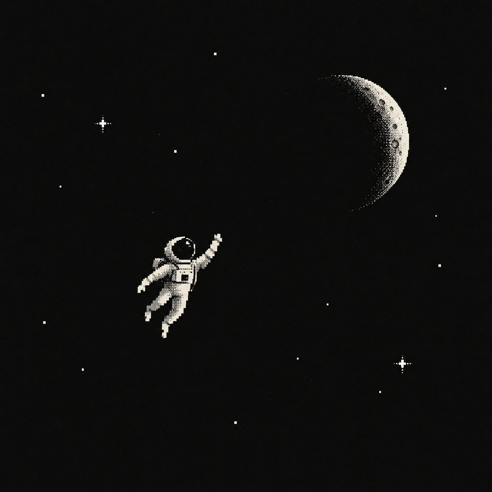

  

<h1 align="center"><code>Welcome to gtzall's GitHub</code></h1>

<code>&lt;/&gt;</code>

  
  
  

<h3 align="center"><code>◉ About me</code></h3>

<table>
<tr>
<td width="72%" valign="middle" align="center">

Olá! Eu sou <strong>Gustavo Almeida</strong>, desenvolvedor web brasileiro.

Construo interfaces com intenção, estudo novas ferramentas e transformo ideias em experiências digitais.

<code>Front-end · React · TypeScript · JavaScript</code>

</td>
<td width="28%"></td>
</tr>
</table>

<h3 align="center"><code>◉ Technologies</code></h3>

  
  
  
  
  
  
  
  

<h3 align="center"><code>⌁ Statistics</code></h3>

<table>
<tr>
<td width="50%"></td>
<td width="50%"></td>
</tr>
</table>

<code>built with curiosity · gtzall · 2026</code>

